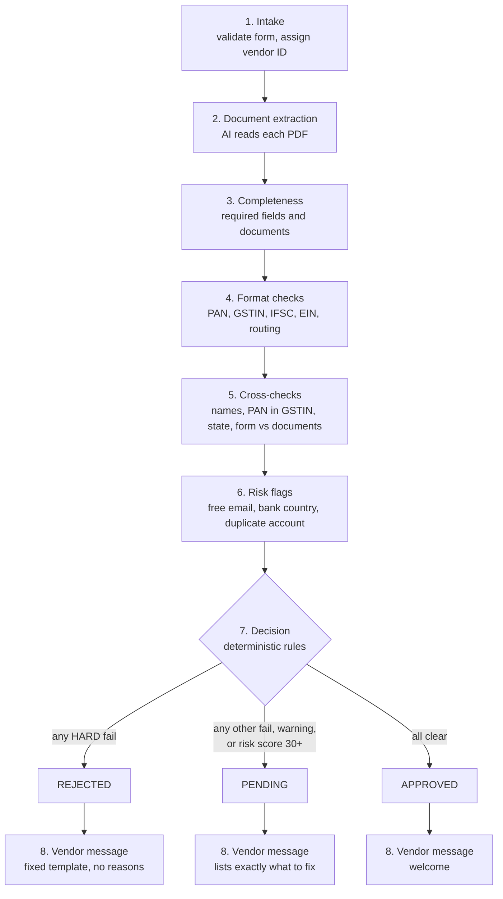

# Vendor Onboarding Automation

Built for the Zamp AI Solutions Analyst case study (PS-2).

**What it does**
- Takes a vendor submission (form fields plus PDF documents), runs it through 8 stages of checks, and returns **APPROVED, PENDING or REJECTED** with every reason visible.
- AI reads the documents and drafts emails. **It never makes the decision**: every check and the final status are plain, deterministic Python.
- For anything not approved, it drafts a message telling the vendor exactly what to fix. A person approves it before it goes out.

**Live demo:** _link to be added after deployment_

---

## The problem and why it matters

Onboarding a vendor means checking a form against a stack of documents (tax registration, PAN, bank proof). Done by hand it is slow, inconsistent between reviewers, and easy to get wrong in the ways that cost real money:

- **Payment diversion:** the bank account on the cheque belongs to a person, not the company.
- **Borrowed registrations:** a valid-looking GST number that belongs to a different business.
- **Duplicate vendors:** the same bank account registered under two vendor names.
- **Back-and-forth delays:** a wrong or unreadable document, discovered days later, with a vague "please resend".

The goal is a process that is fast, explains every decision, and asks the vendor for exactly what is missing.

## Assumptions

| Assumption | Detail |
|---|---|
| Buyer | An Indian mid-size company |
| Vendors | India (main) or USA |
| India requires | GST certificate, PAN card, and a cancelled cheque or bank letter |
| USA requires | W-9 form and a bank letter |
| Bank ownership | Checked against the uploaded cheque or bank letter (production would use penny-drop verification) |
| GSTIN | Checked by format, checksum and PAN consistency (production would call the GSTN API) |
| Vendor emails | Drafted by the system, approved by a human before sending. In this demo, "approve" only marks the email as sent; nothing is emailed |

## How it works

Eight stages run in order, and the page shows each one finishing live.



Every check returns a structured result (check ID, stage, PASS / FAIL / WARN, severity, plain-English reason) and every stage result is stored, so any decision can be explained later.

## Decision rules

| Outcome | When |
|---|---|
| **REJECTED** | Any **HARD** FAIL in any stage (for example bank holder name does not match, PAN inside GSTIN differs, bank account already used) |
| **PENDING** | Any **SOFT** FAIL (fixable, such as a wrong or unreadable document), any **WARN** (for example a name score of 75 to 89), or a **risk score of 30 or more** |
| **APPROVED** | None of the above |

- A WARN never rejects.
- **Risk flags add up.** Each adds to a risk score (capped at 100): free email domain 15, bank country differs from company country 30, duplicate bank account 100. One weak signal alone does not block a vendor; at 30 or more the vendor goes to a person.
- **Names:** after normalising ("Pvt Ltd" becomes "Private Limited", punctuation and case removed), a score of 90 or more passes, 75 to 89 is a WARN, below 75 is a HARD FAIL.
- **Fail safe:** if any stage crashes, it is marked FAILED, the other stages still run, and the final status can never be APPROVED. It becomes PENDING for a person to look at.
- All thresholds, required documents and per-check severities live in [backend/app/rules.yaml](backend/app/rules.yaml), not in code.

### Where AI is used, and where it is not

| AI (Gemini) is used for | Why |
|---|---|
| Reading fields from PDFs and photos | Documents vary in layout and quality; this is what AI is good at |
| Classifying the document type | Catches "an invoice uploaded as a GST certificate" |
| Drafting the vendor email for PENDING cases | Natural wording; built only from the list of missing items |

| AI is **not** used for | Why |
|---|---|
| Any check or the final status | A decision must be the same every time and explainable to an auditor. AI output can change between runs |
| REJECTED emails | A fixed template that states no reason, so nothing sensitive or wrong can be sent |

All Gemini calls live in one file, [backend/app/llm.py](backend/app/llm.py).

## The 8 demo cases

Each sample case is a set of generated PDFs. Run them from the Submit page.

| # | Vendor | Input | What it shows | Expected | What it proves |
|---|---|---|---|---|---|
| 01 | Sharma Electronics | Everything valid and consistent | The happy path | **APPROVED** | 26 checks pass, risk score 0, welcome email |
| 02 | Kaveri Textiles | Cheque and form show bank holder "Ramesh Kumar" | Payment diversion | **REJECTED** | The name check scores 37 against the company name (HARD FAIL) |
| 03 | Deccan Steel Works | Valid GSTIN, but the PAN inside it differs from the PAN given | Borrowed registration | **REJECTED** | Format checks alone pass; the cross-check catches it (`PAN_IN_GSTIN`) |
| 04 | Malabar Spices | An invoice uploaded in the GST certificate slot | Wrong document | **PENDING** | The system detects the real document type and asks for the specific document |
| 05 | Malabar Spices | The correct GST certificate, resubmitted | Fix and resubmit | **APPROVED** | Same vendor ID re-run, both runs kept in history |
| 06 | Coromandel Packaging | A blurry cancelled cheque | Unreadable document | **PENDING** | Unreadable data is never trusted and never guessed; the vendor is asked for a clearer scan |
| 07 | Vellore Traders | Same bank account as Sharma Electronics (run after 01) | Duplicate vendor | **REJECTED** | Duplicate detection works without storing account numbers |
| 08 | Lakeside Analytics LLC (Austin) | W-9 and bank letter, all valid | The USA path | **APPROVED** | Different rules per country (EIN and routing number checks) |

## Design decisions

1. **Deterministic rules, not AI decisions.** The same input always gives the same output, and every reason can be traced to a named check.
2. **`token_sort_ratio` for name matching, not partial matching.** Partial matching rewards one name being *contained* in another, so "R. Sharma" would score high against "Sharma Electronics Private Limited" and an account in an individual's name would pass as the company's own. `token_sort_ratio` ignores word order but not extra words. (See [name_match.py](backend/app/checks/name_match.py).)
3. **Fingerprinted bank accounts.** Full account numbers are never stored. Duplicates are found with a keyed fingerprint (HMAC-SHA256 of account number plus IFSC or routing number); without the secret key it cannot be reversed or guessed. Stored submissions, the API and the UI keep only the last 4 digits.
4. **Text-layer verification of AI output.** When a PDF has a text layer, every value the AI extracts must appear in that text. A value that is not found is capped at confidence 0.5, so it becomes untrusted. This catches an AI misreading or inventing a value.
5. **Expected fields per document type.** `rules.yaml` lists what must be readable on each document (for example IFSC on a cancelled cheque). **The case 06 story:** the blurry cheque was designed to come back with low confidence. In the real Gemini run the model did something more careful: it left the IFSC out rather than guess. Missing data does not lower any confidence score, so a confidence check alone would have passed it. The expected-fields rule closes that gap: the vendor is told "We couldn't find the IFSC on cancelled_cheque.pdf" and asked for a clearer scan.
6. **Fail safe to PENDING.** An error in any stage can never produce APPROVED.
7. **Vendor-facing text comes only from `action_required`.** Every fixable FAIL or WARN carries one plain-English instruction for the vendor. Internal reasons and review notes are never sent to the vendor.
8. **Rejection emails are never written by AI.** They use a fixed neutral template and never state a reason. AI drafts (PENDING only) are checked before use: if a draft leaves out a missing item or mentions a vendor ID, internal review text, "risk score" or "fraud", it is discarded and the template is used.
9. **Prompt-injection handling.** Text inside an uploaded document is treated as data. The extraction prompt tells the model to ignore any instructions in a document, and even if it did not, the model only returns fields: it has no way to set a status, because the decision is code.
10. **The demo extraction cache.** The sample documents are pre-read: [backend/sample_data/extraction_cache/](backend/sample_data/extraction_cache/) is a committed cache of Gemini's reading of every sample PDF, so the demo does not depend on API quota or latency. Any newly uploaded document is read by Gemini live. Only sample documents are ever cached; a real vendor's upload is never written to disk by the cache, because its fields include a bank account number.

## Measured results

All numbers below are from real runs on this code.

| Measure | Result |
|---|---|
| Automated tests (`pytest`) | **263 passed, 1 skipped** (including an end-to-end API test of all 8 cases) |
| Demo cases, mock extractor (`EXTRACTOR_MODE=mock`) | **8 of 8** match the expected status |
| Demo cases, Gemini extractor (`EXTRACTOR_MODE=gemini`, using the committed pre-read cache) | **8 of 8** match the expected status |
| Gemini document-type accuracy (23 sample documents) | **23 of 23 (100%)** |
| Gemini field exact-match (77 fields) | **75 of 77 (97%)** |
| Model | `gemini-3.1-flash-lite` |

The two field misses, from `eval_extraction`:
- Case 04 invoice: the total came back as `1,18,000.00` where the document prints `INR 1,18,000.00` (the currency prefix was dropped; the invoice is not used for any check).
- Case 06 blurry cheque: the IFSC was left out (by design, see decision 5).

Note the Gemini figures come from the cached readings of the sample PDFs, not a fresh API run. The sample documents are synthetic and cleaner than real scans, so accuracy on real vendor documents will differ.

## Limitations and what I would build next

| Limitation today | Next step |
|---|---|
| Bank ownership is checked against the uploaded cheque only | **Penny-drop verification** with a bank API: the real account holder name |
| GSTIN checked by format, checksum and PAN only | **GSTN API lookup**: confirm the registration exists, is active, and matches the name |
| No sanctions or blocklist check | **Sanctions and adverse-media screening** |
| Submissions come through a web form | **Email intake**: vendors reply to a mailbox and the process starts on its own |
| SQLite locally | **Postgres with migrations** |
| Uploaded files stored on local disk | **Persistent file storage** (object storage) |
| Live run events held in memory, so the API must be a single process | **Multi-worker event bus** (Redis) |
| No login | **Authentication and roles** for reviewers and approvers |
| "Approve" does not send an email | Connect to a real mail provider |

## How to run locally

You need Python 3.11+ and Node 20+. Run the backend and the frontend in two terminals.

**Backend** (must run as a single process):

```bash
cd backend
python -m venv venv && source venv/bin/activate
pip install -r requirements.txt
cp .env.example .env        # then edit .env: set GEMINI_API_KEY, ACCOUNT_HASH_KEY, EXTRACTOR_MODE
uvicorn app.main:app --port 8000
```

- `EXTRACTOR_MODE=mock` reads the sample PDFs offline (no API key needed); `gemini` reads documents live.
- `DEMO_MODE=true` shows "Reset demo" in the sidebar (under Demo).

**Frontend:**

```bash
cd frontend
npm install
cp .env.example .env        # VITE_API_URL=http://localhost:8000
npm run dev                 # http://localhost:5173
```

**Pages:** Submit (upload your own PDFs or run a sample case), Live run and Result (stages stream in as they finish; the vendor email can be edited and approved), Dashboard (all vendors and counts) and Vendor detail (run history and Resubmit). Reset demo is in the sidebar under Demo.

### Test commands

```bash
cd backend && source venv/bin/activate
python -m pytest                              # all tests
python -m scripts.run_case --all              # all 8 demo cases, expects "8 of 8"
python -m scripts.run_case 04_wrong_document  # one case, with every check shown
cd ../frontend
npm run build && npm run lint
```

### Document reading and the demo cache

Documents are read by Gemini (`EXTRACTOR_MODE=gemini` in `backend/.env`; `mock` reads the sample PDFs
offline). The sample documents are **pre-read**: `backend/sample_data/extraction_cache/` is committed, so the
demo does not depend on API quota or latency. Any newly uploaded document is read by Gemini live.

- `python -m scripts.check_gemini`: which model is fast, reliable and has quota right now.
- `python -m scripts.eval_extraction`: accuracy of the reader on the sample PDFs.
- `python -m scripts.eval_extraction --save-seed`: rebuild the committed cache. Needed after changing
  `GEMINI_MODEL` or the prompt version. The free Gemini tier allows roughly 20 requests per model per day,
  and the 23 sample documents (21 distinct files) need about that many.
